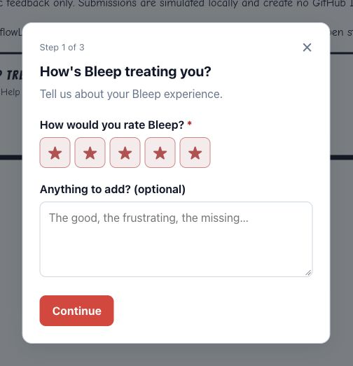
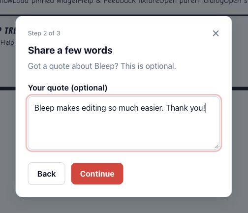
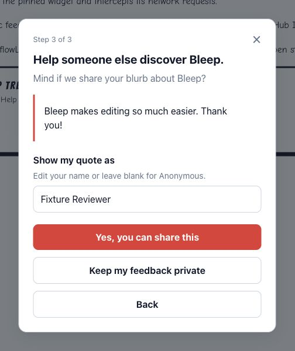
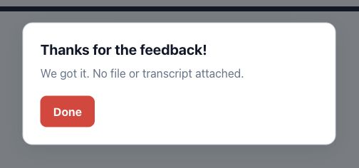
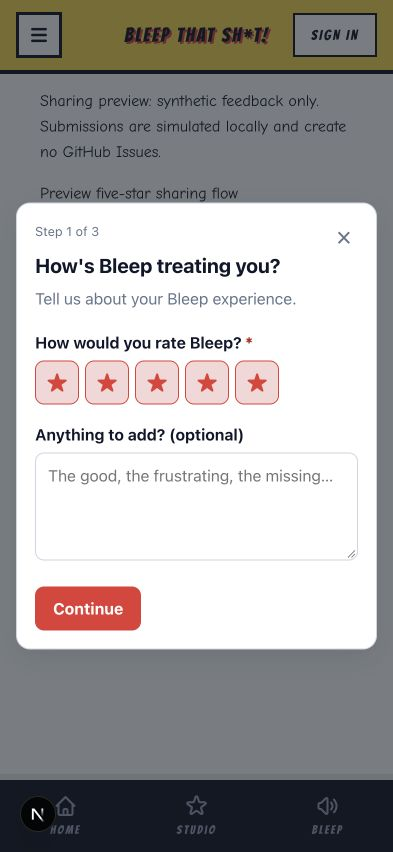
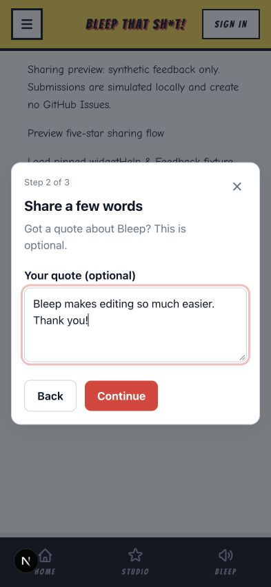
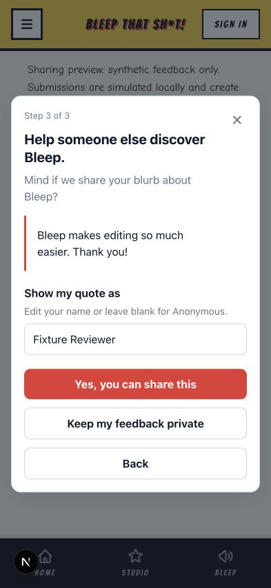
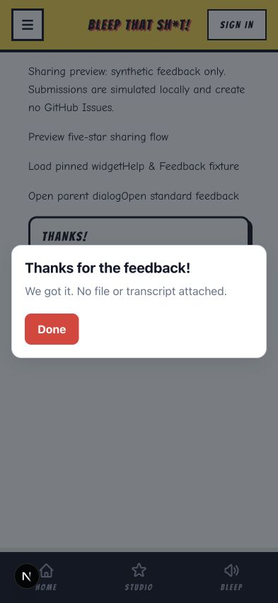

# Original two-button publication flow: design reference

Captured November 3, 2026 from Bleep commit `73fc4636ffdb237c9c7579baf2edf6c4808cd025`
at `/dev/bugdrop-feedback?preview=sharing`, using its earlier pinned BugDrop candidate.
These screenshots specify the requested interaction. They are **not screenshots
of PR #463's current required-radio-choice implementation**, and do not establish
that the current SDK supports the buttons. No application source was changed for
this capture. Both submissions used the development-only simulated endpoint;
no GitHub Issues were created. The quote and account name are synthetic.

The required interaction is:

1. Collect a rating and optional comment. Ratings below five submit without a sharing screen.
2. For five stars with no comment, offer an optional quote (minimum five characters when provided).
   If a comment was entered, skip this extra quote screen and reuse the comment.
3. Show the quote and editable account-name credit, with blank meaning Anonymous.
   **Yes, you can share this** and **Keep my feedback private** each set distinct
   permission metadata and submit the feedback in one action, creating one Issue.
   There is no permission radio group or additional Submit button.
4. Show the acknowledgement. Permission covers the Bleep website only; an empty
   quote cannot authorize publishing a testimonial. Publication remains manual.

PR #463 must restore that interaction while preserving duplicate-click protection,
retry behavior, and hidden-answer cleanup. Restoring buttons does not by itself
justify reinstating every other removed capability; assess them independently.

## Desktop

Captured in real Chrome at a verified 1721 × 907 CSS-pixel viewport. Each image
is cropped around the actual dialog with a small amount of surrounding context.

| Rating | Optional quote |
| --- | --- |
|  |  |

| Permission and editable credit | Confirmation |
| --- | --- |
|  |  |

## Mobile responsive viewport

Captured using the in-app browser viewport override at a verified **393 × 852 CSS
pixels**, without horizontal document overflow. This is responsive viewport
coverage, not real iPhone or Safari emulation. All controls fit in the permission
screen. Desktop exercised Yes; mobile exercised Keep my feedback private. Both
reached the simulated confirmation.

| Rating | Optional quote |
| --- | --- |
|  |  |

| Permission and editable credit | Confirmation |
| --- | --- |
|  |  |

The captured confirmation retains the existing privacy sentence. These images
record the current original preview and do not silently revise its copy.
